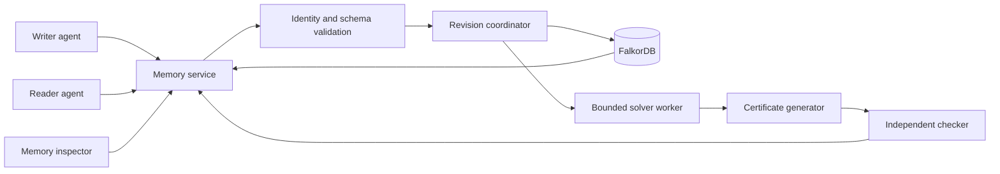

# memopops implementation plan

Prepared for Saqlain and Mahavir on October 17, 2026. Saqlain owns this planning task. This is a build specification, not a claim that the application exists. Estimates are planning budgets; compatibility, performance and guarantees must pass the gates below.

## Product decision

Build shared memory that lets agents ask: **What follows from this workspace's accepted knowledge, why, and does that conclusion still apply after a correction?**

Use release readiness as a concrete demonstration of the memory product. Two independent agent clients share persistent memory across sessions. An observation changes; the old proof remains inspectable, the current decision changes, and the graph identifies the supporting evidence and affected conclusions. This does not require an entire release-management platform.

The strongest submission combines working memory coordination, independently checkable small propositional proofs, and an interface that makes a correction understandable in seconds. Winning cannot be guaranteed. Our controllable advantages are a precise claim, reliable demonstration, measured correctness, and human understanding of the implementation.

## Read this package in order

1. This document: scope, architecture choice, gates and cut policy.
2. [Architecture and algorithms](plan/ARCHITECTURE.md): invariants, logic, graph, revisions, concurrency, proof pipeline and complexity.
3. [Shared contracts](plan/CONTRACTS.md): payloads, semantics, errors, boundaries and canonical demo.
4. [Parallel execution](plan/PARALLEL_EXECUTION.md): ownership, dependencies, file boundaries and integration.
5. [Interface specification](plan/INTERFACE.md): visual system, screens, interactions and accessibility.
6. [Verification and demo](plan/VERIFICATION.md): tests, measurements, release checks and video sequence.
7. [Research ledger](plan/RESEARCH.md): primary sources, implications and limitations.
8. [Planning validation](plan/VALIDATION.md): checks actually performed on this specification and remaining implementation risks.

After the initial pass, read only the relevant detail. Contracts govern interfaces; architecture governs semantics; the execution plan governs temporary ownership. Resolve contradictions in the documents before implementing disputed behavior.

## Scope

| Priority | Deliverable | Observable completion condition |
| --- | --- | --- |
| P0 | Persistent memory in FalkorDB | Real graph queries reconstruct a revision after application/database restart. |
| P0 | Correct Boolean queries | Proved, refuted, unknown, inconsistent memory and solver failure remain distinct. |
| P0 | Safe revision changes | Corrections replace assertions together; stale/incompatible concurrent commits cannot both become current. |
| P0 | Small checkable proof | Demo conclusions export a certificate validated by an independent checker; tampering fails. |
| P0 | Shared agent workflow | Two clients/sessions use the service; a resumed reader consumes the updated memory. |
| P0 | Memory inspector | Memory list, proof explanation, conflict review and history use the real backend. |
| P0 | Quality evidence | Deterministic tests, measured report, README, graph queries and working video. |
| P1 | Model-backed writer and reader | A configured model runs both constrained roles; all calls obey service checks. |
| P1 | Extra usability | Read-only public demo, keyboard polish, counterexample explanation, evaluation export. |
| P2 | Broader platform | MCP, many providers, vector search, arbitrary documents, rich permissions, distributed writers, themes. Defer. |

For Track 02 competitiveness, complete the P1 model adapter as soon as the deterministic two-client path works. Check provider availability at G0; never relabel scripted replay as autonomous AI. Replay remains the dependable test/video fallback.

## Stack

- Backend: Python 3.12 container, FastAPI, Pydantic, official FalkorDB Python client, z3-solver, pytest and Hypothesis. One API process initially; bounded solver worker processes with one Z3 context per job. Local Python 3.13 exists, but the container is the shared target.
- Frontend: React, TypeScript, Vite, CSS variables/modules, TanStack Query for server state. Add a small accessible dialog/menu primitive library only if needed. Proofs use a bounded SVG DAG with deterministic layout.
- Dependencies: pyproject.toml plus uv.lock owned by Saqlain; package.json plus package-lock.json owned by Mahavir. Select compatible stable versions at G0 and lock them. No untested version numbers are prescribed here.
- Local delivery: Docker Compose, persistent FalkorDB volume, API, built frontend. Pin the tested database image by version/digest before release. One instance is sufficient.
- Public delivery: the same stack on a persistent host, database ports private. Read-only public workspace plus operator write access, or capped visitor-isolated workspaces. Complete local setup/video is the supported fallback.

## System view

FalkorDB is authoritative for formula structure, revision membership, evidence, proof support and session history. JSON fixtures seed a real database; they never replace it at runtime.

## Schedule and gates

Official deadline researched: **October 18, 2026, 23:59 IST**. At planning time about 32 hours remained. Aim to freeze scope October 18 at 16:00, complete setup/video by 20:00 and submit by 22:00. Recalculate against actual start time and allow rest; these are work blocks, not continuous-running instructions.

| Gate / elapsed budget | Saqlain | Mahavir | Exit evidence |
| --- | --- | --- | --- |
| G0: 45–60 min | Environment/DB spike, contracts, API skeleton | Challenge contracts, UI scaffold/tokens | Clean start, locked versions, DB and solver smoke success, agreed JSON. |
| G1: next 2–3 h | AST/solver, snapshot read, guarded commit spike | All UI states on fixtures; checker begins | Oracle tests, UI states, one-winner concurrent commit test. |
| G2: next 3–4 h | Real mutation/query API, conflict/persistence | API integration, inspector, checker tests | Browser runs seed → ask → conflict → correction on FalkorDB. |
| G3: next 3–4 h | Certificate generator, dependency impact, client workflow | Proof export, E2E, model adapter | Checked proof, resumed reader changes decision, restart/isolation pass. |
| G4: next 2–3 h | Fault tests, profiling, packaging | UI review, evaluation, rehearsal | No false proof/stale-current answer; report; second-machine setup. |
| G5: protected final 2–3 h | Submission-blocking fixes, technical README | Video, screenshots, submission review | Repo, video, setup, graph model/queries, AI disclosure ready. |

Estimated active work is 14–18 hours per person including integration. If G2 runs late, cut P2 and optional UI work immediately. Protect the final validation/submission window.

Critical path: contract → correct solver/revision protocol → real API → correction flow → checked proof and handoff → failure tests → reproducible demo. UI scaffolding, checker, fixtures and submission outline proceed independently.

G0 has one owner per shared file. Both implementation branches start from its published main commit. Contract changes need an example and matching backend/frontend updates. Publish small validated milestones directly to main at gates, following the fetch/integrate/recheck/retry protocol in docs/COLLABORATION.md; no PR is required. Implementation commands listed in this package are targets to create and verify, not claims of tests already run.

## Initial bounds

128 atoms; 256 active assertions; AST depth 16; 64 nodes per formula; 8,192 active AST nodes total; 32 mutations per request; 64 KiB request body; 10 active sessions per demo workspace. Certificate search: 64 input clauses, 512 generated clauses, 10,000 candidate pairs, one second. These are initial product limits, not measured capacity.

Solver wall budget: three seconds for consistency and query classification, two workers and queue depth 16 initially. Database and certificate work have separate budgets. Adjust once using measurements at G4. A timeout is an explicit result/error, never a proof.

## Cuts and release boundary

Cut in order: extra providers, chat input, full graph canvas, dark mode, streaming, accounts, proof minimization, large formula support. Keep correct statuses, bounded demo certificates, revision checks, provenance, persistence, tenant isolation, meaningful graph queries and working setup.

If the checker is unfinished, label the fallback solver-checked and change the product claim to proof-aware memory. That is weaker than the preferred release. A broken commit protocol is a release blocker; do not compensate with presentation.

Both humans must explain the graph, solver, queries and commit protocol. All P0 cases pass on the pinned environment. Every performance claim has a reproducible run. No fixture masquerades as a real backend/model. The UI works at 200% zoom with loading/error/stale states. README includes track, AI disclosure, limitations, setup and video. A team member verifies the submission receipt.
