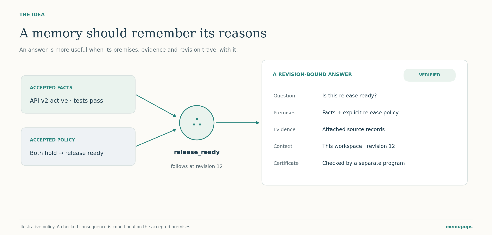
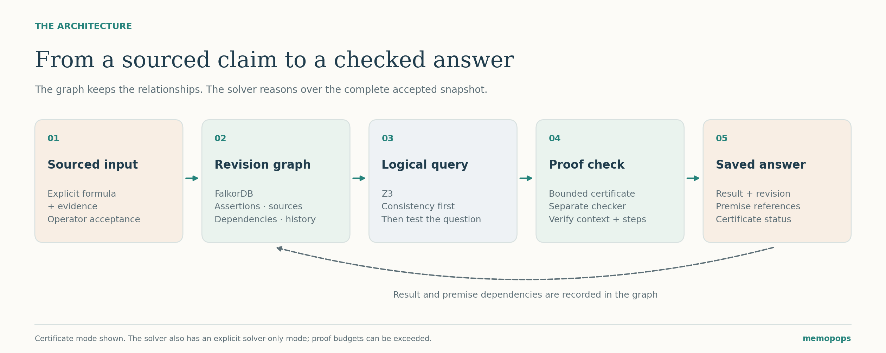
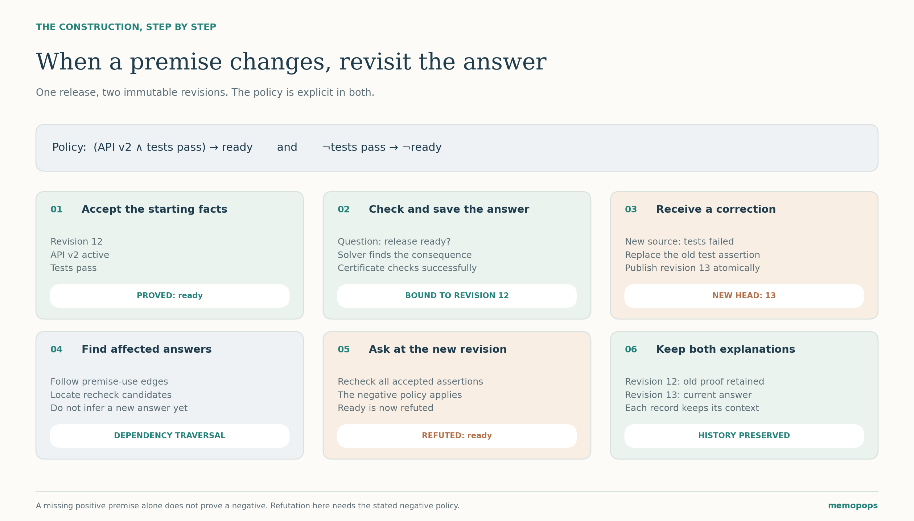
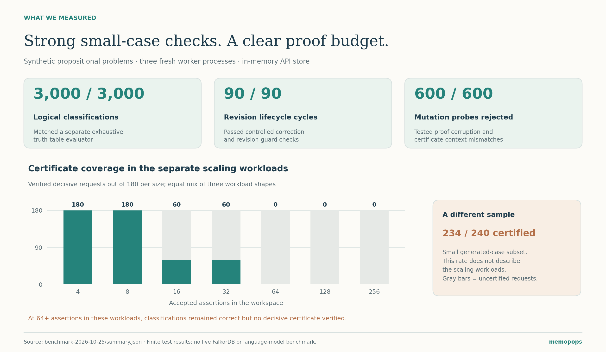

# memopops: Remembering Why an AI Agent Believes Something

*How explicit propositions, a revision graph, and independently checked proofs can make shared agent memory easier to inspect and correct.*

Imagine two AI agents helping a team prepare a software release. One checks the tests and records that they passed. Another uses that information, together with the release policy, to conclude that the release is ready.

A little later, the test result is corrected. The tests actually failed.

The new information can be stored immediately. But what happens to the earlier conclusion? Which answer depended on the old result? Can the second agent explain why it believed the release was ready, and whether that explanation still applies?

That question motivated our work on **memopops**: could shared agent memory retain the reasons behind an answer, and make those reasons checkable when the underlying information changes?

Our initial evaluation gave us encouraging results. Across **3,000 synthetic logic problems**, every classification matched a separate exhaustive truth-table evaluator. We also passed **90 controlled revision lifecycle cycles** and rejected **all 600 tested proof or context mutations**. These are bounded tests of the implemented reasoning and revision machinery; they give us a concrete starting point for evaluating the idea.

## A quick look at agent memory

An agent often needs information from an earlier interaction: a project decision, a test result, a user preference, or a rule agreed on by another agent.

Storing and retrieving that information is useful. For our release example, however, finding the sentence “the release is ready” leaves several questions open. What supported it? Which version of the project did it describe? Did any of its premises change?

We wanted an answer to carry enough structure to revisit those questions.

The starting point is a small distinction: a remembered assertion and a conclusion drawn from assertions play different roles. If we preserve that distinction, we can ask what follows from the currently accepted memory, rather than relying on an earlier summary alone.

## Why we start with propositions

Consider three statements about one particular release:

- API v2 is active.
- The tests pass.
- The release is ready.

Each statement has an explicit meaning and scope. We can then write a policy connecting them:

**(API v2 active AND tests pass) → release ready**

If the first two statements are accepted, the conclusion follows under this policy. The system can record the premises and the rule that support it.

The direction of the rule matters. Learning that the tests did not pass does not, by itself, prove that the release is not ready. Perhaps another accepted policy could establish readiness.

For our correction example, we therefore include a second rule explicitly:

**NOT tests pass → NOT release ready**

With that policy, a corrected negative test result supports a negative readiness answer. The relationship is written into the memory instead of being supplied by an unstated assumption.

In the current application, users define a workspace vocabulary and author formulas using explicit logical operators. This keeps the formal meaning visible. Translating arbitrary conversation into trustworthy formulas remains a separate problem.

## Keeping sources separate from consequences

A test report can support the assertion that the tests passed. A release policy can connect that assertion to readiness. These are different kinds of support.

The source explains where an accepted premise came from. The logical proof explains what follows if the accepted premises hold.

This distinction also sets the boundary of the guarantee. A valid proof cannot make an inaccurate test report accurate. It establishes a consequence of the formal premises we accepted. Recording evidence and requiring deliberate acceptance remain important parts of the workflow.

## What the graph remembers

FalkorDB stores the relationships between workspaces, immutable revisions, assertions, formulas, source evidence, and saved query results. A saved answer records which revision it used and the premises referenced by its proof.

These relationships become particularly useful during a correction. Starting from a replaced assertion, the graph can find answers that used it and identify candidates for rechecking.

An affected answer is not automatically false. Another route through the accepted rules might still establish the same conclusion. Dependency traversal tells us where to look; reasoning over the new revision determines what follows now.

The graph and the reasoning engine have separate responsibilities:

*FalkorDB retains the memory and its relationships. Z3 reasons over the complete accepted snapshot. In certificate mode, a separate checker validates the generated proof and its context.*

Using the complete accepted snapshot matters. A small retrieved subset might omit a conflicting assertion elsewhere in the same revision. Checking the full snapshot allows the system to detect that inconsistency before presenting an ordinary logical answer.

## When a premise changes

The construction is easier to see step by step:

*The same question can have different answers at different revisions. Both explanations remain attached to the premises under which they were produced.*

At revision 12, the accepted memory says that API v2 is active and the tests pass. The positive release policy establishes readiness, and the checked answer is saved against that revision.

An operator then replaces the test assertion using the corrected source. That creates revision 13. The old revision remains available, along with its original answer.

The dependency graph locates earlier answers that used the replaced assertion. Rechecking readiness against revision 13 now applies the explicit negative policy: failed tests imply that the release is not ready.

The earlier proof can still be valid for revision 12. It does not certify the current state at revision 13. Keeping both records makes that difference inspectable.

Updates also name the revision they expect to change. If another writer advances the workspace first, the stale write is rejected rather than silently overwriting the newer state. A contradictory addition is retained in quarantine for inspection instead of being activated alongside an incompatible accepted premise.

## What an answer actually means

We first check whether the accepted memory is internally consistent. If it is, the question has three logical outcomes:

- **PROVED:** the question follows from the accepted premises.
- **REFUTED:** its negation follows from the accepted premises.
- **UNKNOWN:** the premises permit both possibilities.

Unknown is useful information. Missing approval does not mean approval was denied; it may simply mean the memory cannot settle the question yet.

Inconsistent memory receives its own status. A solver that cannot finish also receives a separate status. Neither should be presented as a successful proof or ordinary lack of knowledge.

For decisive answers in certificate mode, a bounded proof generator produces a certificate. A separately implemented checker validates its logical steps and bindings to the workspace, revision, question, and accepted assertions. For unknown answers, checked assignments demonstrate the two remaining possibilities.

The checker is independently implemented and tested; it has not been formally verified in a proof assistant. The application also exposes an explicit solver-only mode. A solver classification and an independently verified certificate are visible as separate outcomes.

## What the experiments showed

We evaluated the existing implementation without changing its limits to improve the score. The run used fixed seeds and three fresh Python worker processes, with the protocol, raw observations, and source revision published alongside the results.

The **3,000-case evaluation** covered proved, refuted, unknown, and inconsistent-memory outcomes equally. Every classification agreed with a separate evaluator that enumerated possible truth assignments. No returned witness failed that independent evaluation.

The lifecycle checks exercised corrections, preserved historical answers, stale writes, and related revision safeguards. All **90 controlled cycles** passed. We also tested **600 mutations across 60 valid certificates**, including damaged proof content and mismatched workspace or revision context. None was jointly accepted by the proof and context checks.

In a smaller generated-case subset, **234 of 240 decisive queries received independently checked certificates**. The remaining six reached the configured proof budget and stayed uncertified.

*The small generated-case certificate result and the scaling experiment are different samples. Showing them together makes the current boundary visible.*

## Where the current approach needs work

The clearest limitation is **proof generation at larger sizes**. In the separate scaling workloads, all decisive requests at four and eight assertions received certificates. Coverage fell at 16 and 32; at 64, 128, and 256 assertions, none received a verified decisive certificate. The logical classifications remained correct, but the bounded proof generator could not supply the required proof. Improving that stage is a concrete engineering priority.

The second limitation is **the scope of the evaluation**. These were synthetic Boolean problems and an in-memory API store. They do not measure free-form language understanding, source truthfulness, or live FalkorDB performance. The results support the tested formal workflow; broader claims need broader experiments.

## How this connects to earlier ideas

Keeping reasons behind beliefs has a long history. Jon Doyle's [work on truth maintenance](https://dspace.mit.edu/handle/1721.1/5733) describes maintaining reasons and revising beliefs when assumptions change. Separately checked solver certificates are also established practice, illustrated by [work on LRAT proof checking](https://arxiv.org/abs/1612.02353). Graph-based agent memory systems such as [Graphiti](https://github.com/getzep/graphiti) address changing, interconnected information over time.

Our project brings explicit propositions, revisioned graph memory, and independent checking together in an inspectable shared-agent workflow. We see it as an engineering exploration of that combination, with measurable behavior and visible limits.

## Questions we want to explore next

The immediate priority is improving certificate generation without weakening the independent checks or losing the connection to the complete revision.

Another direction is helping people author propositions more easily. A language model could suggest a formula and its supporting source, while keeping review of the actual formal meaning explicit before acceptance.

We also want to evaluate the full graph-backed workflow under realistic persistence and concurrent-use conditions. The current benchmark gives us a reproducible foundation for measuring those changes.

## A different starting point for shared memory

The original question was simple: when an agent remembers an answer, can it also remember why that answer followed?

For our release example, the useful record contains the question, the accepted facts, the policy connecting them, the supporting sources, and the revision where the reasoning was checked. When a premise changes, those relationships give us a way to revisit the answer without erasing its history.

That is the direction we are exploring with memopops: shared memory whose conclusions come with reasons we can inspect, check, and reconsider.

---

*Built by Mohammad Saqlain and Mahavir.*

[Explore the source code](https://github.com/SaqlainSQX/memopops) · [Read the benchmark report and access the raw results](https://github.com/SaqlainSQX/memopops/blob/main/docs/evaluation/benchmark-2026-10-25/REPORT.md)
