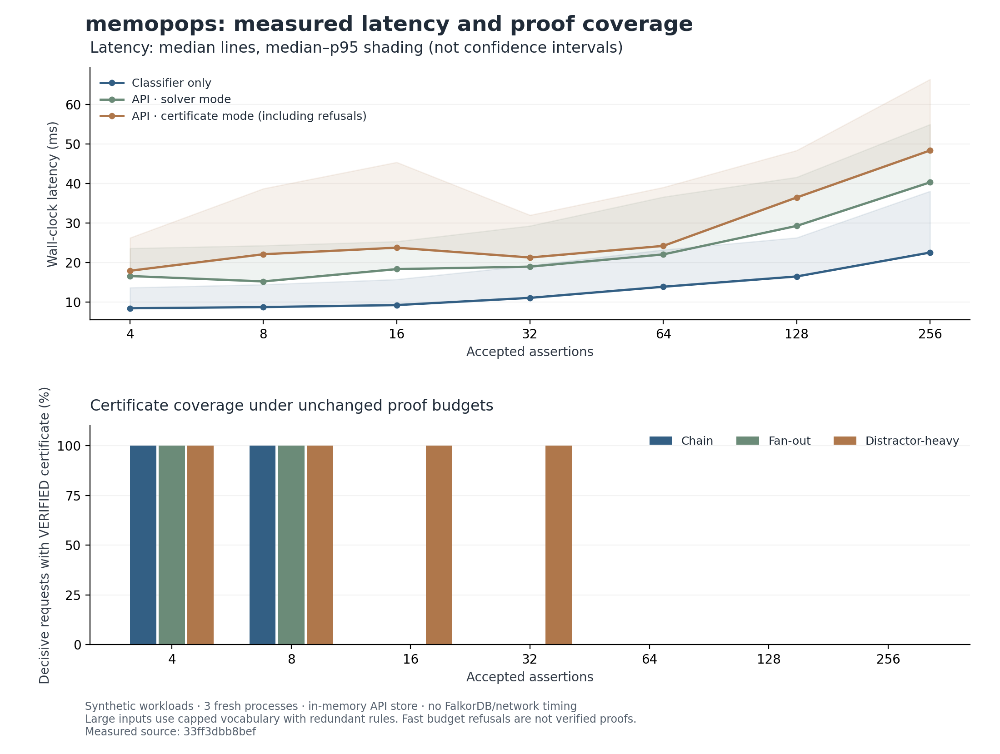

# memopops benchmark results

Measured UTC: 2026-10-25T09:25:35.378701+00:00. Source commit: `33ff3dbb8bef2f450d6aa0e47d2a86fc42d76c2e`.

**Scope: synthetic, single-machine evaluation. The API uses an in-memory test store. FalkorDB/network performance and LLM quality were not measured.**

Environment: Intel(R) Core(TM) i7-14650HX; 24 logical CPUs; Python 3.12.13; Z3 5.3.1.0; Windows-11-10.0.26200-SP0.

Configuration: `{'seeds': [20261025, 20261026, 20261027], 'cases_per_seed': 1000, 'solver_samples': 30, 'api_samples': 10, 'warmup': 5, 'lifecycle_trials': 30}`. Warmups are excluded. Each seed runs in a fresh process; workers run sequentially. Timings use nearest-rank percentiles. Pooled timing counts are repeated measurements, not new logical cases.

## Logical classification

Generated scope: two to six atoms, zero to five premises, and formula recursion depth 0–3. Exact-JSON duplicate cases were removed across seeds; logically equivalent but differently written formulas can remain. This is a bounded synthetic oracle evaluation.

Independent raw-JSON truth-table agreement: **3000/3000 (100.00%)**; witness failures: **0**.
Expected class distribution: `{'REFUTED': 750, 'INCONSISTENT_MEMORY': 750, 'PROVED': 750, 'UNKNOWN': 750}`. Dataset cases are deduplicated across seeds. Descriptive Wilson 95% interval: 99.872%–100.000%. This interval does not establish natural-language accuracy or a deployment error bound.

## Certificates and mutation probes

Generated-corpus decisive attempts: 240; outcomes: `{'VERIFIED': 234, 'BUDGET_EXCEEDED': 6}`. UNKNOWN witness checks: `{'WITNESSES_VALID': 120}`.
Tamper/context probes: 600; jointly accepted: 0. A mathematically valid certificate for a different context is correctly denied by the context check. Applicable evidence probes exclude certificates with no premises. These finite mutation probes do not establish resistance to every attack.

The 600 probes apply ten mutation types to 60 valid generated certificates. Separate untimed diagnostic retries reproduced all six generated-corpus refusals as derived-clause budget limits. Representative scaling diagnostics distinguish derived-clause and initial-clause limits; they never replace the primary timing/coverage observations. See budget-diagnostics.json and scaling-budget-diagnostics.json.

## Scaling and latency

Each size below pools an equal mix of chain, fan-out and distractor-heavy constructions and PROVED/REFUTED/UNKNOWN questions. At 128/256 assertions, vocabulary/depth is capped and extra assertions are redundant rules: these are not implication chains of that depth.

| Assertions | Direct solver p50 / p95 ms | API solver p50 / p95 ms | API certificate p50 / p95 ms | Decisive certificates verified |
| --- | --- | --- | --- | --- |
| 4 | 8.422 / 13.650 | 16.577 / 23.588 | 17.911 / 26.244 | 180/180 |
| 8 | 8.723 / 14.422 | 15.213 / 24.292 | 22.083 / 38.691 | 180/180 |
| 16 | 9.229 / 15.726 | 18.327 / 25.320 | 23.751 / 45.358 | 60/180 |
| 32 | 11.055 / 19.251 | 18.950 / 29.270 | 21.264 / 31.981 | 60/180 |
| 64 | 13.863 / 23.214 | 22.047 / 36.587 | 24.198 / 39.018 | 0/180 |
| 128 | 16.466 / 26.273 | 29.254 / 41.582 | 36.444 / 48.356 | 0/180 |
| 256 | 22.512 / 38.040 | 40.270 / 54.931 | 48.330 / 66.333 | 0/180 |

**Certificate-mode latency includes refusals and budget limits. A fast request that did not generate a certificate is not a fast verified proof. Read latency together with coverage.** Complete topology/status/per-process data is in summary.json and the raw observations.

## Corrections, history and concurrency guards

Lifecycle cycles: **90/90**; named checks: 1530; failed checks: 0. These include quarantine, immutable historical proof checking, stale decision rejection, tenant/role isolation, idempotent query retry and a two-writer expected-head race. Store concurrency here is an in-memory test double, not evidence about FalkorDB's write transactions.

| Controlled reader after correction | Correct current answers |
| --- | --- |
| fresh_solver | 90/90 |
| query_only_stale_cache | 0/90 |

The fresh solver is a same-reasoner recomputation control, not a competing memory product. The intentionally stale query-only cache demonstrates the failure mechanism it was designed to exhibit. Its failures are not a measured failure rate of RAG, Mem0, Zep or Letta.

## In-process contention

| Concurrent requests | Successes / requests | HTTP statuses | Successful requests/s | Successful p95 ms |
| --- | --- | --- | --- | --- |
| 1 | 288/288 | {'200': 288} | 38.6 | 33.336 |
| 2 | 288/288 | {'200': 288} | 57.6 | 52.073 |
| 8 | 288/288 | {'200': 288} | 62.8 | 196.983 |
| 32 | 162/288 | {'429': 126, '200': 162} | 68.3 | 254.108 |

This is a closed-loop local ASGI experiment: three batches of 32 solver-mode requests per level/process. Requests wait behind a client semaphore before timing starts. Throughput includes the full batch duration; 429s remain in counts and are not counted as successes. These are not network/FalkorDB QPS numbers.

Contention includes the first request's startup per fresh worker; no separate contention warmup was discarded.

## Reproduction and artifacts

See ../../BENCHMARK_PROTOCOL.md for the predeclared protocol. Run the command stored in manifest.json after checking out its source revision. Use a fresh output path. All cases and credentials are synthetic; no user workspace was touched.

- manifest.json: command, source/dependency/hardware metadata, dataset and observation hashes.
- cases-*.jsonl: unique generated logic cases, oracle labels and seeds.
- scaling-cases.json: explicit large-case constructions.
- observations-*.jsonl and observations.csv: raw results including errors/refusals.
- summary.json: descriptive aggregates, class counts, per-process medians and failure examples.
- BLOG_RESULTS.md: a precise blog-ready interpretation with the negative results included.
- latency-and-coverage.png / .svg: post-run plot; matplotlib is optional and not part of the measured environment.

## Claims and limitations

Unexpected failures observed: **0**. No measurements were discarded because they were slow or failed. Warmup failures are retained separately. Results are conditional on the sampled synthetic workloads, recorded hardware and application limits.

Supported: measured agreement with an independent finite truth-table oracle; observed certificate acceptance/rejection and coverage under fixed limits; observed revision behavior against a controlled test store; descriptive latency on this machine.

Not supported: elimination of hallucinations, factual truth of evidence, universal correctness, superiority to other memory systems, real database durability/transaction correctness, production throughput, or performance on natural-language memory benchmarks. Both configured database paths were unavailable during this run.
