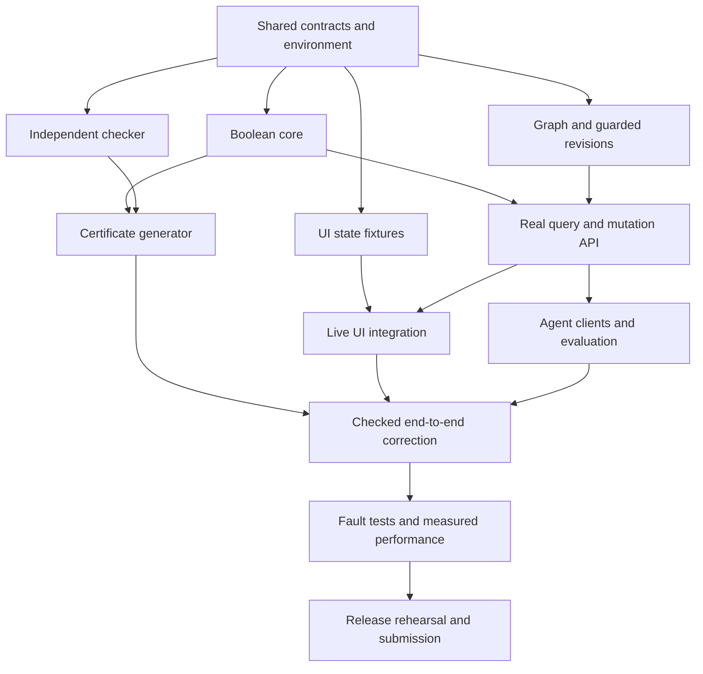

# Parallel execution runbook

The user requested a plan for two people and their agents. Saqlain's agent authored this plan; Mahavir's agent has not yet started or accepted work. Tasks below are assignments to begin when each human starts implementation, not records of completed work. Do not write fabricated activity in Mahavir's log.

## 1. Ownership that avoids collisions

| Owner | Files/modules | Review partner |
| --- | --- | --- |
| Saqlain | `services/memory/`, Python dependency files, `infra/`, `compose.yaml`, `scripts/dev.*`, backend CI | Mahavir reviews protocol/logic interfaces. |
| Saqlain at G0 | `contracts/`, schema fixtures, generated OpenAPI; root setup/README | Mahavir reviews fixture usability before freeze. |
| Mahavir | `apps/web/`, frontend dependencies, frontend/E2E CI | Saqlain checks semantics and real-data integration. |
| Mahavir | `packages/proofcheck/`, `tests/proofcheck/`, standard-library checker CLI | Saqlain reviews input binding and tamper rejection. |
| Mahavir | `agents/`, model adapter, `evaluation/`, `tests/e2e/`, demo video/storyboard | Saqlain reviews service permissions and measured claims. |
| Each | Own personal log and task branch | Both preserve master-log entries. |
| Integration owner Saqlain | Root README final assembly, shared Compose/CI, master-log conflict reconciliation | Mahavir validates clean-machine instructions. |

File paths are planned structure; create them only in assigned implementation tasks. A reviewer provides findings, not unannounced edits in the owner's worktree. Same-machine concurrent sessions need distinct worktrees. Different computers use separate clones. Shared ports and test graphs must also be distinct.

Python packaging: use one root pyproject/uv.lock with packages for memory and proofcheck. Saqlain creates the empty proofcheck package boundary at G0 and reserves its source for Mahavir. Mahavir's checker uses the Python standard library where practical; requests extra dependencies through Saqlain. Frontend dependency changes stay in apps/web. Root CI files have named owners or separate workflow files, never simultaneous edits.

## 2. Dependency graph



S1/S2 are separate tasks in Saqlain's lane, not an instruction to run two writers in one checkout. He can interleave the database spike with core work. Mahavir can build the UI fixture views and checker sequentially while Saqlain's service develops.

## 3. G0 shared bootstrap — 45–60 minutes

**Saqlain S0**

1. Read rules and all plan files. Fetch origin; start `codex/saqlain/bootstrap` from agreed main. Record task claim and intended files in logs/saqlain.md.
2. Check Docker engine availability, not merely docker.exe presence. Run a tiny FalkorDB instance with a disposable test volume and a pinned candidate image. Verify parameterized query, snapshot read, guarded head update, rollback of a deliberately failing publishing query and a two-client one-winner race.
3. Validate Python solver install in the target container. Verify SAT/UNSAT/unknown handling, context isolation and worker spawn. Choose/pin versions in the lockfile. Record tested image digest and runtime versions.
4. Create shared models and fixtures for all five logical states, conflict, revision race, pending suggestion, stale result and certificate error. Fixtures must be labeled development-only and have computed hashes where the schema requires hashes.
5. Define package boundaries, health endpoints, Compose network/volume, .env.example with placeholders, and the checker interface. Add one real DB integration smoke test.
6. Generate OpenAPI; reserve contract changes to Saqlain until G0 merges. Publish a small PR. State any unresolved database/library issue explicitly.

**Mahavir M0, in parallel**

1. Read contracts and ask focused questions as PR findings when necessary: enum values, proof-state distinction, evidence fields, mutation outcomes, freshness and pagination.
2. Create React/TS/Vite shell, spacing/type/color tokens, navigation and API client boundary in a separate branch.
3. Render exactly the proposed fixture shapes; do not invent a second response model or optimistic accepted-memory behavior.
4. Review the demo story and model credential availability with Saqlain. Pick one provider adapter compatible with an available account; no multi-provider framework.

**Gate:** both can start from the same merged bootstrap commit and same fixtures. If the database commit spike fails, stop higher-level write work and fix the protocol. UI and pure checker work can continue.

## 4. Saqlain implementation lane

### S1 Boolean core — 2 hours

- Implement strict AST validation, atom registry lookup, canonicalization/hashes and an independent test oracle for small formulas.
- Implement complete-snapshot SAT classification and total model extraction. Apply the exact result precedence in architecture.
- Add tests for unknown versus refuted, inconsistent K, timeout, unregistered atom, same-context isolation and invalid AST limits.
- Deliver pure-function core, API-independent. Run the target core pytest suite and publish its command/output summary.
- Reviewer asks: can any missing fact, timeout or inconsistent K produce a false proof?

### S2 Graph snapshots and revisions — 2–3 hours

- Implement schema bootstrap, immutable atoms/formulas/assertions/evidence/revisions and indexed identity lookup.
- Implement complete snapshot reconstruction and hash verification with no fallback memory store.
- Implement explicit mutation batches, per-workspace bounded queue, expected-revision publication and receipts.
- Store rejected/pending proposals outside accepted membership. Test replace versus add/retract semantics.
- Test concurrent P/NOT P submissions against the same empty head, retry after lost response and crash before/after publication. Confirm no partial active revision.
- Deliver real database integration tests and sample Cypher queries; no claim of distributed multi-instance readiness.

### S3 API and revision-aware reads — 1.5–2 hours

- Wire authentication/roles, body limits, typed errors and workspace isolation.
- Implement memory/history/query/proposal endpoints first; add impact/events/decision receipt next.
- Run solver in bounded worker processes, track total wall budget, handle cancellation and overload. Do not leave background work running after request deadlines indefinitely.
- Store result with original revision; observe head before response; ensure UI can distinguish historical results.
- Export OpenAPI and make fixtures/actual responses agree. Tell Mahavir which endpoints are live and one reproducible seed command.

### S4 Certificates and graph support — 2–3 hours

- Implement deterministic Tseitin compiler and bounded resolution search against frozen test vectors.
- Call Mahavir's independent checker for decisive results; withhold invalid artifacts. Expose honest budget-exceeded state.
- Persist proof steps and premise edges; derive support by walking the final proof backward. For deduplicated root units, retain all source assertion provenance conservatively.
- Implement graph impact queries and bounded evidence retrieval. No recursive use of derived assertions as premises.
- Demonstrate verified PROVED at r1 and verified REFUTED at r2, plus old proof retrieval after restart.

### S5 Robustness and release service — 2–3 hours

- Run concurrency/fault/isolation suites with real FalkorDB. Fix correctness failures before optimization.
- Measure snapshot load, solver, certificate, check and end-to-end time separately. Inspect indexes/query plans and eliminate N+1 reads if measurable.
- Test production Compose startup, readiness, volume restart and safe seed behavior. Keep secrets out of output/logs.
- Integrate Mahavir's completed tasks through PRs; update README setup and limitations using verified commands.

## 5. Mahavir implementation lane

### M1 Interface foundation — 1.5–2 hours

- Implement the split-view shell and all result/status components from INTERFACE.md.
- Use explicit development fixture mode with a visible label. Do not silently enable mocks when API calls fail.
- Build memory rows, inspector, proof steps, revision selector, conflict sheet and query form. Preserve selection in URL parameters.
- Add keyboard/focus behavior and responsive layouts now, not as a last-minute repair.
- Deliver screenshots of light mode at desktop and narrow width, including long evidence and error states.

### M2 Independent checker — 2–3 hours

- Build a standard-library checker and CLI in packages/proofcheck. Do not import Z3, the generator, or its compiler.
- Reconstruct/validate formula-variable definitions and expected initial clauses from the original AST forest. Independently evaluate consistency/witnesses.
- Check parent ordering, complementary pivot, exact resolvent, empty clause, hashes and support mappings.
- Mutate each trust boundary: extra clause, changed query/premise, scope/revision inconsistent with trusted expected context, missing root, wrong pivot, forward parent, invalid witness and malformed limits. Invalid mathematics/binding fails with a useful reason. Without expected context, the CLI explicitly reports provenance unverified.
- Review S1 oracle cases from a second implementation perspective; agree golden vectors before S4 integration.

### M3 Live UI integration — 2 hours

- Generate types from agreed OpenAPI. Use one API client layer and server-state keys containing workspace/revision/query.
- Replace each fixture screen with real endpoints incrementally. Empty/error states stay distinct from fixture mode.
- Wire explicit add/replace/query actions, conflict review, history, evidence and certificate download. Do not implement optimistic accepted-memory writes.
- Handle 409 with reload and manual resubmission after review. Reject out-of-order results after workspace/revision changes.
- Deliver a browser E2E path on the real seed database; include a screenshot/trace on failure.

### M4 Agent clients and evaluation — 2–3 hours

- Create two separate client sessions: observer/writer and planner/reader. Give them different identities; reader cannot write premises. A human operator or trusted fixture activates observations according to policy.
- First create deterministic replay using the real service, then one model-backed adapter. Tool allowlist: propose assertion, inspect memory, query conclusion, record revision-bound decision. No arbitrary shell/Cypher/web execution.
- Model outputs must validate against the same AST/tool schemas. Require explicit atom mapping; ambiguous suggestions remain pending. Cap tool steps (e.g. 6), input/output budgets and retries. Store sanitized calls/results, never hidden reasoning or credentials.
- Restart/resume the reader session with only persisted IDs; it reads the new revision and changes its recorded decision.
- Implement evaluation runner and simple baselines in evaluation/. Report correctness and abstentions, not fabricated intelligence or win predictions.
- If credentials are absent or model integration misses the gate, document replay mode clearly. Saqlain's critical backend work continues independently.

### M5 Presentation and second-machine rehearsal — 2–3 hours

- Finish contrast/focus/zoom/reduced-motion checks and real-state screenshots.
- Run clean clone + setup on Mahavir's environment or a clean container, without Saqlain's local caches. File precise setup bugs.
- Produce evaluation report from raw measured outputs, storyboard, demo recording and screenshots. Saqlain cross-checks each technical claim.
- Prepare submission content/AI disclosure. Both humans rehearse the technical explanation.

## 6. Working agreements at integration

- One owner per schema/lockfile. Log claim + branch + file scope before edits; publish branch/PR so the other person can see it.
- Prefer PRs under roughly 400 changed source lines where coherent; do not split a necessary atomic change just to satisfy a line count.
- Every PR includes task ID, behavior, contract changes, exact checks and known gaps. Cross-review correctness-sensitive changes before main.
- At G1/G2/G3, integrate once tests pass. Each person fetches main before the next task. Neither agent rebases or resets the other's branch.
- Add one master milestone per integrated task and details to the owner's log. Preserve both append entries if logs conflict.
- If blocked for 20 minutes, write the concrete failing command/error and switch to independent work. Do not invent an interface to bypass the blocker. Saqlain resolves shared contracts; Mahavir resolves visual decisions within the stated design.
- Proposed path/package changes require an ownership update here. A plan is not a mutex; tell the teammate before editing their files.

## 7. Commands to establish, then verify

Saqlain creates these targets during bootstrap and records the real invocation in README. They are not available in the repository yet:

```text
docker compose up --build
uv sync --frozen
uv run pytest tests/core tests/integration
uv run python -m proofcheck <exported-certificate.json>
uv run python -m evaluation.run --suite acceptance --output <run-directory>
npm --prefix apps/web ci
npm --prefix apps/web run typecheck
npm --prefix apps/web run build
npm --prefix apps/web run test:e2e
```

Repository tests need configuration for a dedicated test graph prefix. Never seed/reset the current demo as an incidental test setup step. Mark unsupported/skipped checks explicitly.

## 8. Copyable starting prompts

**For Saqlain's implementation agent:**

> You work for Saqlain. Read AGENTS.md and docs/IMPLEMENTATION_PLAN.md, then its architecture/contracts/runbook. Implement S0 through the next agreed gate in your own task branch. Own services/memory, graph/Cypher, solver, revisions, Python dependencies and infrastructure. Preserve Mahavir's reserved files. Start with the database guarded-write spike and contract fixtures. Do not claim certificates are verified until proofcheck accepts them. Record exact checks and handoffs in logs/saqlain.md. Use PRs and integrate at gates; do not start the entire roadmap blindly if a foundational test fails.

**For Mahavir's implementation agent:**

> You work for Mahavir. Read AGENTS.md and docs/IMPLEMENTATION_PLAN.md, then contracts/interface/runbook. Start M0/M1 against the frozen fixture contract, then M2 independent checker. Own apps/web, packages/proofcheck, agents, evaluation and E2E tests. Coordinate any Python dependency or contract change with Saqlain. The checker must not import the generator or Z3. Use separate checkout/branch, write logs/mahavir.md only for observed work, and publish small PRs. Connect the UI to real endpoints as Saqlain supplies them; never hide API failure with fixture fallback.

These prompts are handoff artifacts. No message has been sent to another chat and no extra agent has been launched by this planning task.
