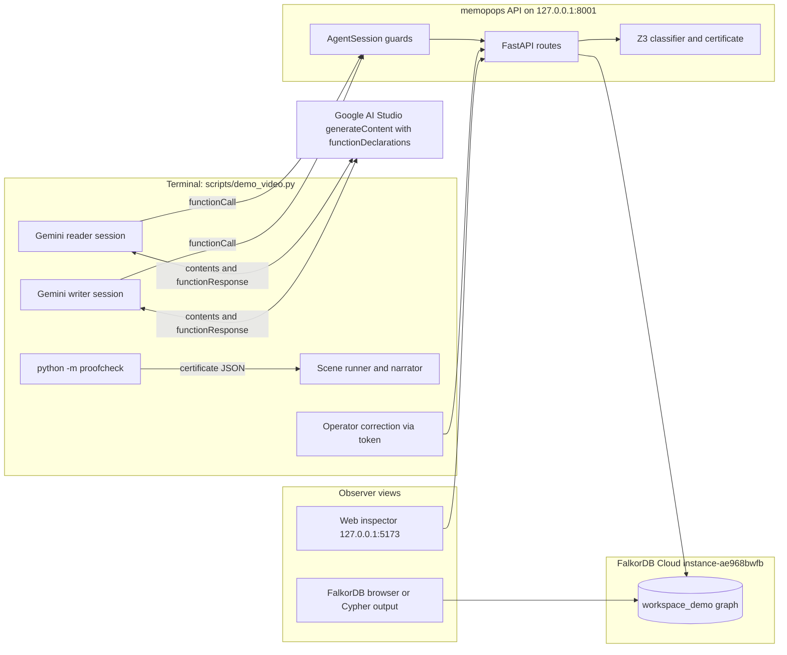

# Video demo plan: Gemini-driven agents over proof-carrying memory

Status: implemented and validated (2026-10-18) under `M-20261018-01`, with repeat-run portability corrected under `M-20261018-02`. This remains the design and recording rationale; current commands are in `docs/DEMO.md`.

The `rev_001` references below describe the canonical seeded story, not a runner constraint. The implemented runner discovers its baseline revision from the API, validates that the canonical facts are present, and offers explicit `--reset` reseeding for repeat takes.

This file is the single source of truth for the demo video. It is written so an agent that has never seen this repository can implement and record it. Human instructions for the current task take precedence.

## 1. Goal and decisions already made

Produce a 3.5 to 4 minute screen recording for the FalkorDB Graph Hacks Track 02 submission (deadline 2026-10-18 23:59 IST). Decisions confirmed with the human on 2026-10-18:

- Gemini (Google AI Studio, `gemini-flash-latest`) drives the reader and writer agents through **native function calling**. Scripted replay stays available as a recording fallback and must be labeled as such on screen.
- On screen: a **narrated terminal run** is the spine; the existing **web inspector** is an observer view; a **FalkorDB graph/Cypher view** shows the proof-dependency traversal.
- The recording uses the **hosted FalkorDB Cloud instance** (`instance-ae968bwfb`, FalkorDB v4.22.0), not local Compose.

Why the frontend still matters even though the logic is the story: judges need to see state change without reading JSON, and FalkorDB must look central for this track. The inspector already renders memory, quarantined proposals, history impact, and certificate download, so it costs nothing to show. The graph view is what proves FalkorDB does the dependency traversal.

## 2. What the video must prove

1. Two agent identities share one memory and the service, not the model, decides what becomes accepted memory.
2. A conclusion (`release_ready` PROVED at `rev_001`) carries a certificate that an independent checker verifies.
3. A writer proposes a conflicting claim but its writer credential is denied activation. A trusted operator submits the same observation for validation; it is quarantined and the head does not move.
4. An operator correction creates `rev_002`; FalkorDB traversal lists the earlier PROVED query as affected; the resumed reader is told its old decision is stale and re-derives REFUTED.
5. Tampering with the certificate makes the checker reject it.
6. The graph in FalkorDB holds assertions, formulas, evidence, revisions, query results, and premise edges.

Honesty rules from `docs/SUBMISSION.md`: label live model turns as "Live model: Gemini Flash (function calling)". If any take falls back to scripted replay, label it "Scripted replay". Never describe scripted replay as model autonomy. Report measured results only.

## 3. Current state of the code (verified 2026-10-18)

- `agents/model.py`: `OpenAICompatibleModel` posts to Google's native `generateContent` with header `X-goog-api-key`, reads `MEMOPOPS_MODEL_API_KEY`, `MEMOPOPS_MODEL_BASE_URL`, `MEMOPOPS_MODEL_NAME` from env or the gitignored `.env`. It returns **plain text only** (`{"type": "text", ...}`) and sends **no tools**. `AgentSession._handle` records text as `ignored_text` and does not execute anything. So Gemini cannot act today.
- `agents/session.py`: `AgentSession` executes exactly four tools (`inspect_memory`, `query_conclusion`, `propose_assertion`, `record_decision`), caps steps at `MAX_STEPS = 6`, rejects unknown argument keys, gates writer tools by role, and enforces that `record_decision.choice` follows the query result (`PROVED -> ship`, `REFUTED -> hold`, else `abstain`). Decisions `ship`/`hold` need `proof_status` `VERIFIED`. A stale `expected_revision_id` yields `REVISION_CONFLICT`. `AgentSession.resume(journal, ...)` restores decisions from a journal. These guards are the product; do not loosen them for the demo.
- `agents/scripts.py`: `ScriptedReleaseReader` and `ScriptedFailureWriter` are deterministic replays. `ScriptedReleaseReader(prior_decision=...)` deliberately re-records the old decision first to trigger `REVISION_CONFLICT`, then re-inspects and re-queries.
- `agents/operator.py`: `submit_revision`, `inconsistent_failure_add()` (adds `NOT tests_pass` beside `tests_pass`: quarantined), `replace_passing_tests()` (replaces `as_tests_pass` with `NOT tests_pass`: commits `rev_002`).
- `scripts/run_agent_demo.py`: lab/acceptance/remote modes. Remote mode needs `--api-base` and `MEMOPOPS_AUTH_TOKENS`. Requires `PYTHONPATH=.` because `agents/` and `evaluation/` are top-level packages.
- `scripts/seed_demo.py`: idempotent seed of `workspace_demo` at `rev_001` with atoms `api_v2`, `tests_pass`, `release_ready`, `docs_signed` and four assertions. Refuses to run if the workspace head is not `rev_001`. Reads `.env` for FalkorDB settings.
- `packages/proofcheck`: `python -m proofcheck CERT.json [--expected-context MANIFEST]`; exit 0 when logically valid, 1 when invalid, 2 when unreadable.
- Web app `apps/web`: Vite dev server on `127.0.0.1:5173` proxies `/api` to `MEMOPOPS_API_ORIGIN` (default `http://127.0.0.1:8010`). Sections: Memory (with Quarantined submissions panel), Queries (Check, Download certificate, Record decision), History (Affected prior queries from `GET /impact?revision=`). Health polls every 3 s.
- Graph schema labels in `src/memopops/store.py`: `Workspace`, `Revision -[:INCLUDES]-> Assertion -[:ENCODES]-> Formula`, `Assertion -[:SUPPORTED_BY]-> Evidence`, `QueryResult -[:USES_PREMISE]-> Assertion`, `Proposal`, `RequestReceipt`, `Atom`. Graph name per workspace comes from `graph_name_for_workspace(workspace_id)` (prefix `mempops_`).
- Hosted FalkorDB: host `r-6jissuruar.instance-ae968bwfb.hc-7up0crkyn.ap-south-1.aws.f2e0a955bb84.cloud`, port `52904`, username `falkordb`, TLS **off** (TLS on timed out). Password is in the human's `.env`; never print or commit it. The instance was left with 0 graphs after testing.
- Gemini: `gemini-flash-latest` returned text through this client. `gemma-4-31b-it` timed out / HTTP 500; `gemma-4-26b-a4b-it` worked for text but is not needed. Use Gemini Flash; it supports function calling.
- Machine: Node v20.20.0 (web build and tests pass; `vitest` warns), Python 3.12 via `uv`, Docker available, Chrome at `/usr/bin/google-chrome`. Host port `8000` and `6379` are occupied by unrelated services; use `8001` for the API.

## 4. Architecture of the demo



The model proposes tool calls; `AgentSession` validates and executes them against the published API; FalkorDB stores everything; the inspector and graph view only read.

## 5. Implementation work

Keep one focused change per commit. Do not change `AgentSession` guards, the API, the store, or the solver. Do not add dependencies; use `urllib`, `json`, and ANSI escape codes.

### 5.1 New module `agents/gemini_tools.py`: `GeminiFunctionCallingModel`

Purpose: turn Gemini function calls into `AgentSession` actions and feed tool outcomes back as `functionResponse` parts. Reuse `post_generate_content`, `_load_local_model_env`, `LIVE_*_ENV`, `DEFAULT_LIVE_MODEL`, `generate_content_url`, and `_redact_secret` from `agents/model.py`.

Constructor and factory:

- `GeminiFunctionCallingModel(complete, *, role, goal, model_name, endpoint_url, atom_ids_hint=None, temperature=0.0)` where `complete(payload, timeout)` performs the HTTP call. Inject a fake in tests.
- `from_env(role, goal)` returns `None` when `MEMOPOPS_MODEL_API_KEY` is missing (same contract as `OpenAICompatibleModel.from_env`).
- Attributes used by the runner: `mode = "live_model"`, `supports_tools = True`, `model_name`, `last_rationale: str`, `transcript: list[dict]` (redacted copy of each request/response summary for the artifact folder).

Function declarations (the surface the model sees; keep it flat so the schema is simple and the model cannot invent nested ASTs):

- `inspect_memory(rationale: string, revision_id?: string)`
- `query_conclusion(rationale: string, revision_id: string, atom_id: string, negated?: boolean)`
- `propose_assertion(rationale: string, expected_revision_id: string, atom_id: string, negated: boolean, reason: string, client_ref: string, evidence_uri: string, evidence_excerpt: string, observed_at: string)` writer only
- `record_decision(rationale: string, expected_revision_id: string, query_id: string, choice: "ship" | "hold" | "abstain")`
- `finish(rationale: string, summary: string)`

Mapping to `AgentSession` arguments (the session rejects unknown keys, so the adapter must produce exactly these):

- `inspect_memory` -> `{}` or `{"revision_id": ...}`
- `query_conclusion` -> `{"revision_id", "query": {"op":"atom","id": atom_id}` or `{"op":"not","arg":{"op":"atom","id": atom_id}}`, `"proof_mode"}`. Use `certificate` for decisive release queries and `solver` for the `docs_signed` uncertainty scene because UNKNOWN has no decisive certificate.
- `propose_assertion` -> `{"expected_revision_id", "atom_id", "formula": <same AST rule>, "reason", "client_ref", "evidence": {"uri", "excerpt", "observed_at"}}`
- `record_decision` -> `{"expected_revision_id", "query_id", "choice"}`
- `finish` -> `{"type": "stop"}`; store `summary` in `last_rationale`.
- Always strip `rationale` and keep it in `last_rationale` for narration.

Request body shape (Google native API):

```json
{
  "systemInstruction": {"parts": [{"text": "<role card>"}]},
  "contents": [
    {"role": "user", "parts": [{"text": "<observation JSON>"}]},
    {"role": "model", "parts": [{"functionCall": {"name": "inspect_memory", "args": {"rationale": "..."}}}]},
    {"role": "user", "parts": [{"functionResponse": {"name": "inspect_memory", "response": {"event": {"...": "..."}}}}]}
  ],
  "tools": [{"functionDeclarations": [ ... ]}],
  "toolConfig": {"functionCallingConfig": {"mode": "ANY", "allowedFunctionNames": ["..."]}},
  "generationConfig": {"temperature": 0}
}
```

- `allowedFunctionNames` for reader: `inspect_memory`, `query_conclusion`, `record_decision`, `finish`. Writer adds `propose_assertion`. This mirrors `_READER_TOOLS` / `_WRITER_TOOLS` in `agents/session.py`; the session still enforces it server-side.
- `next_action(observation)`: on the first call append the observation as a user text part. On later calls append the previous event as `functionResponse` (name = previous tool). Then call Gemini, take the first `functionCall` part from `candidates[0].content.parts`, append the model part verbatim to `contents`, map, and return. If no `functionCall` part is present, return `{"type": "text", "content": <joined text>}` once; on the second consecutive text-only reply return `{"type": "stop"}` so the session cannot loop.
- Truncate the observation and each functionResponse to `MAX_MODEL_CHARS` (8000) like the existing client.
- Retry policy: on HTTP 429/500/503 or timeout, retry up to 3 times with 2 s, 4 s, 8 s backoff; then raise `RuntimeError` with the redacted body. The runner catches this and switches to scripted fallback for that scene (section 5.2).
- Redaction: never log the API key; reuse `_redact_secret`. Journals already drop credential keys.

Role cards (system instruction). Keep them short and factual; they must not promise tools the model does not have.

Reader card:

```
You are a release reader agent for workspace {workspace_id}. You can only call the provided functions.
Memory atoms are identified by exact ids returned by inspect_memory (for example api_v2, tests_pass, release_ready, docs_signed). Never invent atom ids.
Procedure: 1) inspect_memory to learn the head revision and atom ids. 2) query_conclusion at that head revision for the goal atom. 3) record_decision with the choice that follows the result: PROVED -> ship, REFUTED -> hold, anything else -> abstain. 4) finish with a one-sentence summary.
If the observation lists prior_decision_revision_id and prior_decision_query_id, first call record_decision for that prior decision at its original revision so the service can tell you whether it is still current; if the service answers REVISION_CONFLICT, inspect_memory again and redo the query at the new head.
Each call must include a one-sentence rationale written for a human watching. Goal: {goal}
```

Writer card:

```
You are a writer agent for workspace {workspace_id}. You can only call the provided functions. You may propose memory; you cannot activate it. The service decides acceptance.
Procedure: 1) inspect_memory. 2) propose_assertion for exactly the fact in your goal, using a registered atom id, with the evidence fields from the goal. 3) finish with a one-sentence summary that states the service outcome (quarantined, committed, pending_review, or rejected).
Goal: {goal}
```

Goals used by the runner:

- Reader scene A: `Decide whether release_ready holds at the current head and record the matching decision.`
- Reader scene B (uncertainty): `Decide whether docs_signed holds at the current head using proof_mode solver because an UNKNOWN result has no decisive certificate, then record the matching decision.`
- Writer scene: `You observed that the integration tests for release demo-42 failed. Evidence: uri fixture://demo-42/writer-tests-failed, excerpt "Synthetic writer report: integration tests failed.", observed_at 2026-10-17T12:00:00Z. Propose that tests_pass is false.`
- Reader resume: same as scene A; the observation carries `prior_decision_revision_id` (already added by `AgentSession.run`) and the runner must also add `prior_decision_query_id` and `prior_decision_choice` so the model can re-record. Do this by passing `prior_decision` into the adapter (constructor kwarg) and letting `next_action` merge those keys into the first observation. Do not change `AgentSession.run`.

Step budget check against `MAX_STEPS = 6`: scene A = 3 tool steps; scene B = 3; writer = 2; resume = up to 4 (conflict, inspect, query, decide). `finish` is a stop, not a step.

### 5.2 New script `scripts/demo_video.py`: narrated scene runner

Purpose: one command that walks the storyboard against the running API, prints a readable, color-coded narration, pauses between scenes for the camera, writes artifacts, and never prints secrets.

CLI:

```
PYTHONPATH=. uv run --locked python scripts/demo_video.py \
  --api-base http://127.0.0.1:8001 \
  --model live            # or: scripted
  --pause                 # wait for Enter between scenes
  --take 1                # artifact folder suffix
  --output .artifacts/video-demo
  --scenes all            # or a comma list: memory,reader,uncertain,writer,correction,resume,verify,graph
```

Tokens come from `MEMOPOPS_AUTH_TOKENS` (load `.env` the same way `scripts/seed_demo.py` does, without printing). Token names are configurable with defaults `local-reader-token`, `local-writer-token`, `local-operator-token` (these match `.env.example`). Workspace `workspace_demo`.

Output conventions:

- A scene header line: `== Scene 2: Reader decides at rev_001 ==` and a mode banner on every agent step: `[Live model: Gemini Flash, function calling]` or `[Scripted replay]`. The banner is what the camera shows; it must be truthful per scene.
- For each agent step print three blocks: `Agent says:` (the rationale), `Tool call:` (name and the mapped arguments, pretty JSON), `Service answered:` (the event with `outcome`, `result`, `proof_status`, `freshness`, `support_assertion_ids`, `revision_id`, `head_revision_id`, status codes, or `code: REVISION_CONFLICT`).
- Formulas printed in human form using the same operators as the UI (`api_v2 AND tests_pass -> release_ready`). Implement a tiny `pretty(formula)` in the script; do not import from the web app.
- Never print tokens, the API key, or the FalkorDB password. Print the FalkorDB host with the middle elided and the port.

Scenes (in order; each is a function that returns a dict written to `summary.json`):

0. `preflight`: `GET /api/v1/health/ready` (expect `ready`), `GET /workspaces/workspace_demo` (expect head `rev_001`; if not, stop and tell the operator to run the reset script in 5.3), model mode and model name, whether the key is present (boolean only).
1. `memory`: `GET /memory?revision_id=rev_001`; print four assertions with pretty formula, evidence excerpt and URI, and the knowledge hash (first 12 chars).
2. `reader`: `AgentSession(role="reader", mode="live_model", model=GeminiFunctionCallingModel.from_env("reader", goal A))` with `UrlTransport`. Journal at `<output>/reader.json`. Expected path: inspect -> query `release_ready` at `rev_001` -> PROVED, VERIFIED, support ids `as_api_v2, as_tests_pass, as_ready_rule` -> `record_decision ship` -> `PROCEED` receipt with `decision_id`. Save `query_id` and `revision_id` for scenes 6 and 7.
3. `uncertain`: fresh reader session, goal B, journal `<output>/reader-docs.json`. Expected: solver-only query `docs_signed` -> UNKNOWN -> `abstain` (local receipt, `persisted: false`). Narrate: "missing facts do not imply negation".
4. `writer`: writer session with goal above, journal `<output>/writer.json`. Expected: the writer's `propose_assertion` is rejected with 403 because a writer cannot activate memory. The runner then uses the trusted operator token to submit the same conflicting observation for validation; expected outcome `QUARANTINED`, with `proposal_id` and `base_revision_id rev_001`. Then `GET /workspaces/workspace_demo` shows the head is still `rev_001`, and `GET /proposals?status=QUARANTINED` lists it. Do not claim the writer directly quarantined or activated the proposal.
5. `correction`: operator token, `submit_revision(expected_revision="rev_001", idempotency_key=f"video-correction-{take}", reason="Operator replaces the passing test report after the reader decision.", mutations=replace_passing_tests())` -> 201 COMMITTED, `rev_002`. Then `GET /impact?revision=<rev_002>`: expect `total_count >= 1` with the scene 2 `query_id`, `result PROVED`, `dependency_basis CHECKED_SUPPORT`, `changed_assertion_ids ["as_tests_pass"]`. Narrate that this list came from a FalkorDB traversal `QueryResult -[:USES_PREMISE]-> Assertion`.
6. `resume`: `AgentSession.resume(<output>/reader.json, model=GeminiFunctionCallingModel.from_env("reader", goal A, prior_decision=<scene 2 decision>))`. Expected: `record_decision` at `rev_001` -> `REVISION_CONFLICT` with `head_revision_id rev_002` -> inspect -> query at `rev_002` -> REFUTED, VERIFIED -> `hold` -> `BLOCK` receipt. Print the journal's decisions list showing the first decision now `historical`.
7. `verify`: `GET /queries/<scene 2 query_id>/certificate` with the reader token; write `<output>/certificate-rev_001.json`. Run `uv run --locked python -m proofcheck <file>` via `subprocess` and print the report and exit code (expect 0, `logical_valid true`). Then write a tampered copy: load the JSON, find the first resolution step list and delete one step (or change a clause literal); write `<output>/certificate-tampered.json`; run proofcheck again (expect exit 1). Inspect `packages/proofcheck/src/proofcheck/check.py` to pick a field that exists; do not guess.
8. `graph`: connect with `FalkorSnapshotStore.from_env()` and run two Cypher queries against `graph_name_for_workspace("workspace_demo")`, printing rows:

```cypher
MATCH (q:QueryResult {revision_id: 'rev_001'})-[:USES_PREMISE]->(a:Assertion)-[:ENCODES]->(f:Formula)
OPTIONAL MATCH (a)-[:SUPPORTED_BY]->(e:Evidence)
RETURN q.id, a.id, f.canonical_json, e.uri
ORDER BY a.id
```

```cypher
MATCH (r:Revision)-[:INCLUDES]->(a:Assertion)
RETURN r.id, r.sequence, collect(a.id) AS members
ORDER BY r.sequence
```

Also print the Cypher text itself so the camera can read it, and print the same two queries to `<output>/graph-queries.cypher` for pasting into the FalkorDB browser.

Fallback: if `--model live` and `GeminiFunctionCallingModel.from_env` returns `None` or raises after retries, the runner prints `Live model unavailable: <redacted reason>` and reruns that scene with `ScriptedReleaseReader` / `ScriptedFailureWriter` under the `[Scripted replay]` banner. Record `fallback_used: true` in `summary.json`. If any fallback happened, the video caption for that scene must say scripted replay.

Artifacts under `<output>/` (gitignored `.artifacts/`): `summary.json`, journals, certificates, `graph-queries.cypher`, `gemini-transcript.json` (redacted request/response summaries: model name, function names, rationales, HTTP status; no key, no raw prompt dump beyond 2000 chars per turn).

### 5.3 New script `scripts/reset_demo_workspace.py`

Retakes need `workspace_demo` back at `rev_001`. `scripts/seed_demo.py` refuses when the head is not `rev_001`, so provide a guarded reset:

- Reads `.env` like `seed_demo.py`; connects with `FalkorSnapshotStore.from_env()`.
- Deletes exactly one graph: `graph_name_for_workspace("workspace_demo")`, and only if it exists and `--yes` is passed. Prints the graph name it will delete and the full list of other graphs it will not touch.
- Then calls `scripts.seed_demo.main()` to reseed.
- Refuses to run if `FALKORDB_HOST` is empty. Never deletes any other graph. Document in `docs/DEMO.md`.

### 5.4 Tests (no network)

`tests/test_gemini_tools.py`:

- Fake `complete` returns canned `candidates[0].content.parts` with a `functionCall`; assert the returned action has exactly the session's argument keys, `rationale` is stripped into `last_rationale`, the AST is built for `negated` true and false, and `finish` returns `{"type": "stop"}`.
- Second call appends a `functionResponse` whose `name` equals the previous tool and whose `response` is the event; assert request `contents` ordering (user text, model functionCall, user functionResponse).
- `allowedFunctionNames` excludes `propose_assertion` for the reader.
- No `functionCall` part -> `type: text` once, then `stop`.
- `from_env` returns `None` without the key (use `monkeypatch.delenv` and point `_LOCAL_ENV_PATH` at a temp dir so the real `.env` is not read).
- Retry: fake raising `RuntimeError("HTTP 503")` twice then succeeding -> succeeds; three failures -> raises.
- End-to-end with `AgentSession` + `LabSnapshotStore` + `AsgiTransport` and a scripted fake Gemini that emits inspect -> query -> decide: assert `ship` decision persisted and `mode == "live_model"` in the journal. This proves the adapter speaks the session's contract without calling Google.

`tests/test_demo_video.py` (small): import the scene functions with an `AsgiTransport` lab app in `--model scripted` mode and assert `summary.json` has the expected results for scenes 2, 4, 5, 6 (`PROVED`/`quarantined`/`COMMITTED`/`REFUTED`). Skip scene 7 subprocess and scene 8 FalkorDB when no store is available (mark them as `skipped` in the summary).

Run `./scripts/verify_release.sh` before pushing. Expected: pytest count increases from 144; everything else unchanged.

### 5.5 Docs

- `docs/DEMO.md`: replace the storyboard with the scene list in section 7 below, the exact commands in section 6, the labeling rule, and the reset script.
- `README.md`: in "Agent clients and evaluation", state that with `MEMOPOPS_MODEL_API_KEY` set, `scripts/demo_video.py --model live` runs Gemini Flash with function calling through `AgentSession`; replay remains the default elsewhere.
- `docs/SUBMISSION.md`: after recording, tick "Video" and "Screenshots", add the AI-assistance disclosure sentence, record `git rev-parse origin/main`.
- Logs: add a `MASTER.md` entry when the demo runner is ready for review; task-level detail in the implementer's own log (identify the human first; do not infer from git author).

## 6. Environment and run commands

All commands from the repository root. `.env` is gitignored; edit it by hand, never commit it.

`.env` keys needed (values omitted here on purpose):

```
FALKORDB_HOST=r-6jissuruar.instance-ae968bwfb.hc-7up0crkyn.ap-south-1.aws.f2e0a955bb84.cloud
FALKORDB_PORT=52904
FALKORDB_USERNAME=falkordb
FALKORDB_PASSWORD=<from the FalkorDB Cloud "Parameters" panel>
FALKORDB_SSL=false
MEMOPOPS_AUTH_TOKENS={"local-reader-token":{"workspace_id":"workspace_demo","role":"reader"},"local-writer-token":{"workspace_id":"workspace_demo","role":"writer"},"local-operator-token":{"workspace_id":"workspace_demo","role":"operator"}}
MEMOPOPS_MODEL_API_KEY=<Google AI Studio key>
MEMOPOPS_MODEL_BASE_URL=https://generativelanguage.googleapis.com/v1beta/models/
MEMOPOPS_MODEL_NAME=gemini-flash-latest
```

Replace the three demo token strings with long random values before recording; the inspector form masks the token, but the terminal must never print them.

Terminal 1, API against the hosted database (port 8000 is taken on this machine):

```bash
set -a; . ./.env; set +a
PYTHONPATH=src:packages/proofcheck/src uv run --locked uvicorn memopops.api:app --host 127.0.0.1 --port 8001
```

Terminal 2, seed or reset, then web inspector:

```bash
PYTHONPATH=src:packages/proofcheck/src uv run --locked python scripts/seed_demo.py
# retake: PYTHONPATH=.:src:packages/proofcheck/src uv run --locked python scripts/reset_demo_workspace.py --yes
MEMOPOPS_API_ORIGIN=http://127.0.0.1:8001 npm --prefix apps/web run dev
# open http://127.0.0.1:5173/ , workspace workspace_demo, revision rev_001, paste the reader token
```

Terminal 3, FalkorDB graph view. Preferred: the official browser container pointed at the hosted instance (verify the image tag exists with `docker pull falkordb/falkordb-browser:latest` before recording day; if it does not, use the Cypher output from scene 8 instead):

```bash
docker run --rm -p 3000:3000 falkordb/falkordb-browser:latest
# open http://127.0.0.1:3000 , host/port/user from .env, TLS off, select graph mempops_<hash> (scene 0 prints the name)
```

Terminal 4, the demo:

```bash
PYTHONPATH=.:src:packages/proofcheck/src uv run --locked python scripts/demo_video.py --api-base http://127.0.0.1:8001 --model live --pause --take 1
```

Dry run first with `--model scripted` to check the terminal layout, then `--model live` without `--pause` to confirm Gemini completes all four agent scenes within budget. Only then record.

Verification commands the plan expects to pass before recording:

```bash
./scripts/verify_release.sh
PYTHONPATH=.:src:packages/proofcheck/src uv run --locked python scripts/demo_video.py --api-base http://127.0.0.1:8001 --model scripted --take dry
PYTHONPATH=.:src:packages/proofcheck/src uv run --locked python scripts/demo_video.py --api-base http://127.0.0.1:8001 --model live --take dry-live
```

## 7. Storyboard, screen layout, and voiceover

Length target 3:40. Resolution 1920x1080, 30 fps. Layout: terminal (runner) left 60 percent, browser right 40 percent with two tabs (inspector, FalkorDB browser). Font size 16 or larger in the terminal. Hide the dock and notifications. Pre-connect both browser tabs before recording so no token or password is typed on camera.

Recording tool on this machine: OBS Studio (`sudo apt install obs-studio`) or SimpleScreenRecorder; either records a region. Record system audio off, microphone on. One take per scene is acceptable; `--pause` lets the narrator breathe and the browser be refreshed between scenes. Stitch with any editor or record in one pass.

Captions to overlay (bottom-left) when the terminal banner is not readable: `Live model: Gemini Flash (function calling)` or `Scripted replay`, and `FalkorDB Cloud ap-south-1` during scenes 5 and 8.

| Time | Scene | Terminal shows | Browser shows | Voiceover (spoken) |
| --- | --- | --- | --- | --- |
| 0:00-0:20 | 0 Preflight | health ready, head rev_001, model gemini-flash-latest, graph name | Inspector connected, Memory tab | "memopops is proof-carrying shared memory for agents on FalkorDB. Two agents, one memory, and every answer carries its reasons. Memory for release demo-42 is at revision 1." |
| 0:20-0:40 | 1 Memory | four assertions, formulas, evidence | Memory list; click `as_ready_rule` to show evidence in Inspector | "Memory is not text. It is four accepted assertions with evidence: API v2 is available, tests pass, and two policy rules. Each is a node in FalkorDB linked to its formula and evidence." |
| 0:40-1:15 | 2 Reader | Gemini rationale, inspect, query PROVED VERIFIED, ship, PROCEED receipt | Queries tab: Check release_ready -> PROVED, Download certificate | "A reader agent, driven live by Gemini Flash through function calling, asks whether the release is ready. It cannot write memory. The service proves release_ready from three premises with Z3, builds a resolution certificate, and an independent checker marks it VERIFIED. The agent records a PROCEED decision bound to revision 1." |
| 1:15-1:30 | 3 Uncertain | query docs_signed UNKNOWN, abstain | Queries tab: docs_signed -> not established | "Ask about something memory does not know, and you get UNKNOWN, not a guess. Missing facts never imply negation." |
| 1:30-1:55 | 4 Writer | Gemini writer proposes NOT tests_pass; writer activation is denied; operator review submits it and receives QUARANTINED; head still rev_001 | Memory tab: Quarantined submissions panel appears | "A second agent reports the tests failed. Writer credentials cannot activate memory. A trusted operator submits the observation for validation; the service finds a contradiction and quarantines it. The head does not move, and the claim and source remain available for review." |
| 1:55-2:25 | 5 Correction | operator replace -> rev_002 COMMITTED; impact lists the PROVED query | History tab: select rev 2 -> Affected prior queries shows the release_ready result | "A trusted operator replaces the passing test report. That is revision 2. FalkorDB traverses QueryResult to USES_PREMISE to Assertion and tells us which earlier conclusions depended on the removed fact: the PROVED release_ready query." |
| 2:25-2:55 | 6 Resume | REVISION_CONFLICT, re-inspect, query at rev_002 REFUTED VERIFIED, hold, BLOCK; decisions list shows first decision historical | Queries tab at rev 2: release_ready -> REFUTED | "The reader comes back later and tries to reuse its decision. The service refuses: revision conflict. The agent re-reads memory, re-queries, and now release_ready is REFUTED with a verified certificate. It records BLOCK. No stale proof is ever served as current." |
| 2:55-3:20 | 7 Verify | proofcheck exit 0 report; tampered file exit 1 | (terminal only) | "Certificates are checked outside the service. Export, run proofcheck, valid. Change one step, and it is rejected. Trust comes from the math, not from the server." |
| 3:20-3:40 | 8 Graph | the two Cypher queries and rows | FalkorDB browser: run the saved Cypher, show the graph | "Everything you saw is a graph in FalkorDB Cloud: revisions include assertions, assertions encode formulas and cite evidence, query results point at their premises. Bounded propositional logic, explicit premises, and honest labels. That is memopops." |

Limits to state once (end card or last line): propositional logic only; results are conditional on accepted premises; certificate search has fixed limits and reports BUDGET_EXCEEDED rather than a false result; no live model autonomy is claimed beyond what the banner shows.

## 8. Recording-day checklist

1. `git fetch origin && git status -sb`; work on `codex/<person>/video-demo`, merged with `origin/main`.
2. `./scripts/verify_release.sh` passes.
3. `.env` has hosted FalkorDB, random tokens, Gemini key. Confirm `uv run --locked python -c "from agents.model import live_credentials_present as p; print(p())"` prints `True` (prints a boolean only).
4. Hosted instance: `reset_demo_workspace.py --yes` then `seed_demo.py` output says seeded at `rev_001`.
5. API on 8001 `ready`; inspector on 5173 connected with the reader token; FalkorDB browser on 3000 connected and graph selected.
6. Dry run `--model scripted`, then `--model live` without pause; check `summary.json` has `fallback_used: false`.
7. Reset again, start recording, run with `--pause`.
8. After recording: copy `summary.json`, journals, certificates to `docs/evaluation/video-run/` only if they contain no tokens (journals are redacted by `AgentSession.save`; check `grep -c token` is zero), take two or three real-UI screenshots for `docs/SUBMISSION.md`, update the checklist, record `git rev-parse origin/main`.
9. Upload the video; test the link while signed out.

## 9. Risks and mitigations

- Gemini returns text instead of a function call: `toolConfig.mode = ANY` plus `allowedFunctionNames` makes a call mandatory; the adapter still handles a text reply by stopping after two.
- Gemini picks a wrong atom id or revision: the service answers `pending_review` or `REVISION_CONFLICT`; the runner shows it. That is acceptable footage (it demonstrates the guard) but costs steps; re-take if the budget of 6 is exceeded.
- HTTP 503 "high demand" seen earlier on Gemma: use Gemini Flash; retries with backoff; scripted fallback with truthful banner.
- Hosted FalkorDB login: use username `falkordb`, TLS off; `default` and TLS on both failed.
- Port collisions: 8000 and 6379 are in use on this machine; use 8001 and the hosted database.
- Node 20 warnings from vitest are cosmetic; the inspector dev server runs.
- FalkorDB browser image or connection UI differs: fall back to scene 8 terminal output; the Cypher is saved to a file for pasting.
- Secrets on camera: pre-connect browser tabs; the runner never prints tokens, key, or password; do not open `.env` on screen.

## 10. Out of scope for this task

Changing `AgentSession` guards, API routes, solver, store, or UI features; model-proposed activation; exact conflict cores; deployment; registration. Suggest, do not do, any of these.
