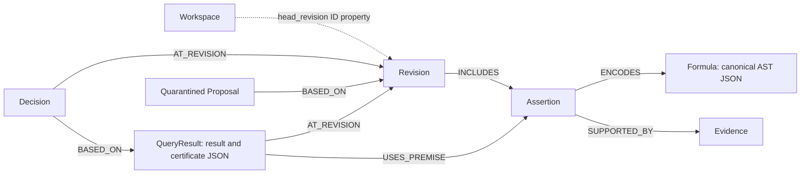

# Implemented graph model and essential queries

Audited against implementation `e9bd8c3`, October 18, 2026. This describes the code in [store.py](../../src/memopops/store.py) and [seed_demo.py](../../scripts/seed_demo.py), rather than the broader original architecture proposal.

## Storage

Each authorized workspace selects a separate FalkorDB graph. The graph name is `mempops_` plus the first 40 hex characters of SHA-256(workspace ID); this is naming/isolation, not encryption. API authentication decides workspace access before selecting it.

| Node | Important stored data | Relationships |
| --- | --- | --- |
| Workspace | `id`, `head_revision`, `sequence` | Head is an ID property, not a HEAD edge |
| Atom | `id`, `label`, `meaning`, `scope` | Registry records; no formula-to-atom graph edges in this MVP |
| Revision | ID, sequence, parent ID, knowledge hash, semantics; committed revisions also record actor, reason, removed assertion IDs | `INCLUDES` Assertion |
| Assertion | Immutable ID, formula hash, actor, acceptance, creation time | `ENCODES` Formula; `SUPPORTED_BY` Evidence |
| Formula | Content hash, canonical JSON Boolean AST | No separately persisted Boolean operator nodes |
| Evidence | ID, URI, excerpt, observed time, content digest | Referenced by assertions |
| QueryResult | Workspace/revision IDs, result JSON including proof bundle, query/knowledge hashes, actor/time | `AT_REVISION` Revision; `USES_PREMISE` Assertion |
| Proposal | Quarantined request, base revision, reason, actor/time | `BASED_ON` Revision; excluded from accepted membership |
| Decision | PROCEED/BLOCK, rationale, actor/time, revision/query IDs | `AT_REVISION` Revision; `BASED_ON` QueryResult |
| RequestReceipt | Key, request hash, original outcome JSON | `REFERS_TO` committed Revision, Proposal, QueryResult, or Decision |



The dashed line describes a property reference, not a persisted relationship. Atom registry and request-receipt nodes are omitted from the drawing for readability.

## 1. Reconstruct accepted knowledge

The server runs this in the already authorized workspace graph with a bound `revision_id` parameter:

```cypher
MATCH (r:Revision {id: $revision_id})-[:INCLUDES]->(a:Assertion)-[:ENCODES]->(f:Formula)
RETURN a.id AS assertion_id,
       f.canonical_json AS canonical_json,
       f.hash AS formula_hash
ORDER BY a.id
```

`load_snapshot` also reads the revision manifest and atom registry. It parses every formula, checks canonical form/formula hashes, and recomputes the complete sorted knowledge hash. There is no vector search or top-k subset pretending to be the complete accepted memory.

## 2. Retrieve evidence through relationships

The memory inspector's source path is revision → assertion → evidence:

```cypher
MATCH (w:Workspace {id: $workspace_id})
MATCH (r:Revision {id: $revision_id})-[:INCLUDES]->(a:Assertion)-[:ENCODES]->(f:Formula)
OPTIONAL MATCH (a)-[:SUPPORTED_BY]->(e:Evidence)
RETURN a.id AS assertion_id, f.hash AS formula_hash,
       collect({id:e.id, uri:e.uri, excerpt:e.excerpt,
                observed_at:e.observed_at, content_digest:e.content_digest}) AS evidence
ORDER BY assertion_id
```

This is a focused version of the memory read; the implementation additionally returns and validates acceptance/actor/time metadata. URIs are source labels; the server does not automatically fetch them.

## 3. Identify affected prior queries after a correction

`get_revision_impact` first loads the selected revision's parent and removed assertion IDs. It then counts affected results and reads a bounded page. This count query is from the implementation:

```cypher
MATCH (w:Workspace {id: $workspace_id})
MATCH (r:Revision {id: $parent_revision_id})
MATCH (q:QueryResult {workspace_id: $workspace_id, revision_id: $parent_revision_id})
MATCH (q)-[:USES_PREMISE]->(a:Assertion)
WHERE a.id IN $changed_assertion_ids
RETURN count(DISTINCT q) AS total_count
```

For independently verified proofs, `USES_PREMISE` records checked support; for other results it conservatively records the complete snapshot. The API reports the dependency basis. The current impact view covers queries at the **immediate parent revision**, not an unbounded history of all descendants or cached external decisions.

A removed supporting assertion means the old support needs review. It does not prove the conclusion is now false: another derivation may exist, or the new result may be UNKNOWN. Re-query the new revision to decide.

## 4. Guard publication in the graph write

The accepted-revision write begins by matching the expected current head and absence of an existing receipt. It creates revision/membership/evidence, moves the head, and writes the receipt in the same parameterized graph command. Decision writes similarly check both the current head and the referenced query's revision.

```cypher
// Opening guard only: not a complete standalone mutation query.
MATCH (w:Workspace {id: $workspace_id})
MATCH (parent:Revision {id: $expected_revision_id})
WHERE w.head_revision = $expected_revision_id
OPTIONAL MATCH (prior:RequestReceipt {key: $key})
WITH w, parent, prior WHERE prior IS NULL
// Full bounded publication and receipt creation follow in store.py.
```

Review the full `publish_revision`, `persist_query_result`, and `persist_decision` methods for executable writes. Do not make a distributed multi-instance concurrency guarantee from this single-instance design; the real DB rehearsal and targeted concurrency tests remain separate evidence.

## Division of responsibility

FalkorDB reconstructs accepted revisions, keeps provenance/history, and traverses premise dependencies. Z3 checks propositional consistency/entailment. The separate `proofcheck` package validates small resolution certificates, original formulas, witnesses, and optional trusted context. Proof steps are in exported/stored JSON, not separately persisted proof-step graph nodes. There is no implemented Event feed in this snapshot.

Without FalkorDB the production memory path cannot load/persist these records. `evaluation/lab_store.py` and the browser harness are explicit test substitutes, not the product's production storage.
